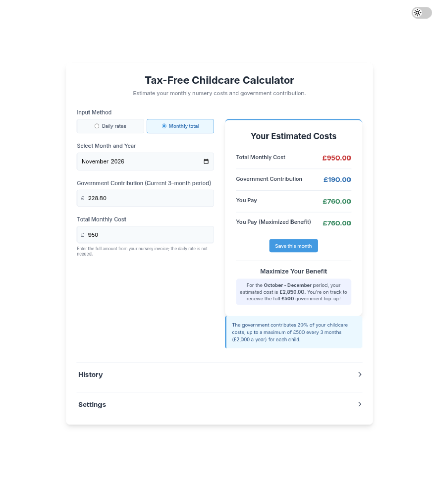
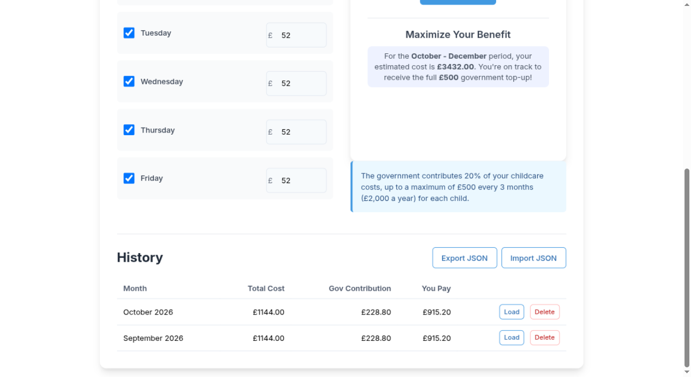

# UK Tax-Free Childcare Calculator


A simple web application to help UK parents estimate their monthly nursery costs and the government's contribution through the Tax-Free Childcare scheme.

## Features

- Calculate total monthly childcare costs based on daily rates and selected days.
- Amounts are displayed with thousands separators (e.g. £1,092.35); they are stored as integer pence internally to avoid rounding drift.
- **Monthly total input:** enter the full amount from your monthly nursery invoice instead of digging out the daily rate.
- **Rate prefill:** "Use last saved rates" / "Use last saved total" buttons fill the form from the most recent saved month, so you rarely need to re-enter anything.
- **Leftover balance:** already have money sitting in your TFC account? Enter it and the results show the exact amount to transfer so the account covers this month's invoice (respecting the period cap).
- Factor in the 20% government top-up.
- **Configurable top-up period:** the £500 cap runs per 3-month period, anchored to the month you opened your childcare account rather than calendar quarters — set it in Settings, and the remaining allowance is shown under the government contribution input.
- Show the breakdown of the user's share and the government's share.
- Provides an optimization hint to maximize the government benefit, using the saved months for the part of the period that already happened and projecting only the months ahead.
- **Month history:** save each calculated month (total cost, government contribution, amount paid) to your browser and browse it in a table, in a collapsible section below the calculator so the core stays front and centre.
  - Selecting a month prefills the government contribution paid so far in the current 3-month period from the saved months (you can still edit it).
  - Reload a saved month back into the form, or delete it.
  - **Export/Import JSON:** download the history as `tfc-history.json` for backup, or import it into another browser.
- **Theme Switcher:** Toggle between light and dark modes for comfortable viewing.





## How to Use

1.  **Clone the repository:**
    ```bash
    git clone https://github.com/AfonsoNeto/UK-tax-free-childcare-calculator.git
    cd UK-tax-free-childcare-calculator
    ```

2.  **Run a local web server.**
    Since the application uses ES modules, you need to run it from a web server. Opening the `index.html` file directly in the browser will not work due to CORS policy. Here are a few common options:

    **Using Python:**
    If you have Python installed, you can use the built-in HTTP server.
    ```bash
    python3 -m http.server
    ```

    **Using npm:**
    ```bash
    npm start
    ```

    Then open your browser and go to `http://localhost:8000`.

3.  **Use the calculator:**
    -   Pick an input method: enter the **daily rate** for each nursery day, or just the **total monthly cost** from your invoice.
    -   Select the month and year you want to calculate for.
    -   Enter your current government contribution for the 3-month period if you have any (it is prefilled from your saved months when available).
    -   The estimated costs will be displayed automatically.
    -   Click **Save this month** to store the result in the history table below.

4.  **Manage your history:**
    -   Use **Load** on a saved month to bring its inputs back into the form.
    -   Use **Export JSON** to download your history as a file, and **Import JSON** to restore it (e.g. in another browser).

## Running the tests

The calculation and storage logic is covered by tests that use Node.js's built-in test runner — no dependencies to install.

```bash
npm test
```

Requires Node.js 18 or newer. The tests also run automatically on every push and pull request via GitHub Actions.

## Technologies Used

- HTML
- CSS
- JavaScript
- Tailwind CSS
- Node.js built-in test runner (`node:test`)
