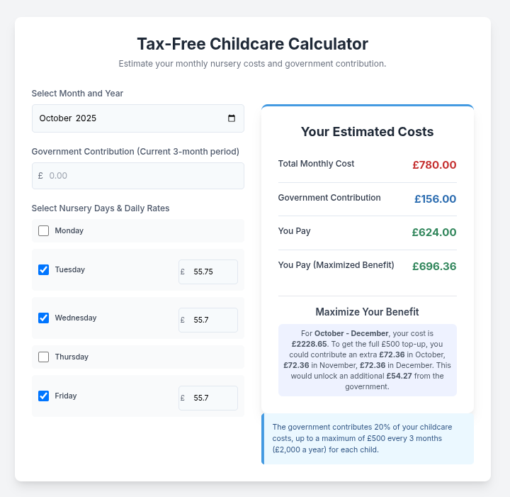

# UK Tax-Free Childcare Calculator



A simple web application to help UK parents estimate their monthly nursery costs and the government's contribution through the Tax-Free Childcare scheme.

## Features

- Calculate total monthly childcare costs based on daily rates and selected days.
- Factor in the 20% government top-up.
- Show the breakdown of the user's share and the government's share.
- Provides an optimization hint to maximize the government benefit.

## How to Use

1.  **Clone the repository:**
    ```bash
    git clone https://github.com/your-username/UK-taxfree-childcare-calculator.git
    cd UK-taxfree-childcare-calculator
    ```

2.  **Run a local web server.**
    Since the application uses ES modules, you need to run it from a web server. Opening the `index.html` file directly in the browser will not work due to CORS policy. Here are a few common options:

    **Using Python:**
    If you have Python installed, you can use the built-in HTTP server.
    ```bash
    # For Python 3
    python3 -m http.server
    ```
    Then open your browser and go to `http://localhost:8000`.

    **Using npx (Node.js):**
    If you have Node.js installed, you can use the `serve` package via `npx`.
    ```bash
    npx serve
    ```
    It will give you a local address to open in your browser (usually `http://localhost:3000`).

    **Using Bun:**
    If you have Bun installed, you can use its built-in HTTP server.
    ```bash
    bunx serve
    ```
    Then open your browser and go to `http://localhost:3000`.

3.  **Use the calculator:**
    -   Select the month and year you want to calculate for.
    -   Enter your current government contribution for the 3-month period if you have any.
    -   Select the days of the week your child attends the nursery.
    -   Enter the daily rate for each selected day.
    -   The estimated costs will be displayed automatically.

## Technologies Used

- HTML
- CSS
- JavaScript
